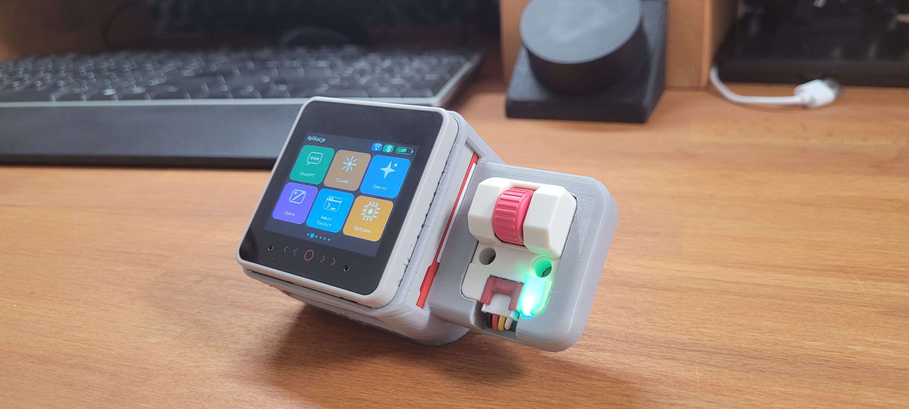

# M5Stack Touch Control Deck



**Strona projektu i instalator online (PL/EN):** [M5Stack-Touch-Control-Deck.lepczynski.it](https://m5stack-touch-control-deck.lepczynski.it/)

Dotykowy, bezprzewodowy panel sterowania oparty na **M5Stack CoreS3 SE**, działający jako klawiatura Bluetooth HID i kontroler multimediów. Dostępne są profile skrótów dla **Windows 10/11, macOS i Linux (GNOME/Ubuntu)**. Po nowym parowaniu panel poprosi o wybór systemu. Do codziennego sterowania nie potrzebujesz aplikacji działającej na komputerze.

**Status:** Windows pozostaje sprawdzoną wersją bazową. Testy na macOS Tahoe potwierdziły działanie Monitora aktywności, Findera, zmiany aplikacji, zrzutów ekranu i blokowania Maca. **v0.2.3** usuwa pytanie o Spotlight, otwiera adresy w wybranej przeglądarce (ustawianej w panelu AP) i wysyła `F11` dla funkcji Pulpit. Te dwie poprawki wymagają jeszcze potwierdzenia na fizycznym Macu. Linux GNOME zależy od ustawień hosta.

## Dwa sposoby wgrania oprogramowania

**1. Bezpośrednio przez przeglądarkę, bez lokalnej kompilacji (zalecane).** Otwórz [instalator WWW](https://m5stack-touch-control-deck.lepczynski.it/), podłącz **M5Stack CoreS3 SE** przez USB-C i wybierz port w Chrome lub Edge. W instalatorze masz dwa tryby: **Aktualizuj** zapisuje tylko aplikację i może zachować Wi-Fi, kafelki i inne ustawienia, **pod warunkiem że NIE wybierzesz „Erase device”** oraz nie zmienił się układ partycji. **Instalacja fabryczna** zapisuje pełny obraz i **usuwa konfigurację NVS**. Nie potrzebujesz Pythona ani PlatformIO. **Nie używaj instalatora z innymi modelami ESP32.**

**2. Z kodu źródłowego, z możliwością własnych zmian.** Pobierz to repozytorium, a w systemie Windows uruchom `tools\upload_windows.bat` po podłączeniu urządzenia przez USB-C. Skrypt przygotuje środowisko, skompiluje firmware i wgra go na płytkę. Tę metodę wybierz, jeśli chcesz modyfikować funkcje, wygląd lub skróty. Szczegółowe instrukcje: [docs/INSTALLATION.md](docs/INSTALLATION.md).

Po wgraniu sparuj **M5 Control Deck** przez Bluetooth z komputerem, a na urządzeniu wybierz **Windows**, **macOS** albo **Linux GNOME**. Zmiana jest później dostępna na ekranie **Połączenia** i w lokalnym panelu konfiguracji pod `http://192.168.4.1`. Bez aplikacji towarzyszącej na komputerze.

**Dokładny opis budowy i działania (po polsku):** [artykuł na forum Forbot](https://forbot.pl/forum/topic/26182-m5stack-control-deck-bezprzewodowy-panel-sterowania-komputerem-na-cores3-se-bez-lutowania/).

**Film z budowy i demonstracją:** [M5Stack Touch Control Deck na YouTube](https://www.youtube.com/watch?v=Jz1xCBi-Q1o).

Dokumentacja po angielsku: [README_EN.md](README_EN.md).

Projekt rozwija pomysł z repozytorium [ESP32 PC Control Deck](https://github.com/lepczynski-cloud/ESP32-PC-Control-Deck). Wcześniejszą konstrukcję można zobaczyć na [filmie w YouTube](https://www.youtube.com/watch?v=16eqHU4j9Fk).

## Najważniejsze funkcje

- sześć ekranów przewijanych pionowym gestem,
- dwa zegary: Polska oraz konfigurowana druga strefa, domyślnie HKT,
- opcjonalna synchronizacja NTP przez Wi-Fi i praca offline z RTC,
- sześć konfigurowanych kafelków stron WWW,
- sterowanie multimediami z ekranu dotykowego,
- opcjonalny Scroll Unit: obrót reguluje głośność, a kliknięcie wysyła Play/Pauza,
- skróty systemowe dobrane do Windows, macOS lub Linux GNOME,
- lokalny portal konfiguracyjny dostępny przez własny punkt AP,
- ikony stanu Wi-Fi, Bluetooth i akumulatora,
- animowany start, czuwanie, wybudzanie i wyłączanie,
- menu zasilania pod krótkim naciśnięciem Power,
- automatyczna propozycja czuwania tylko wtedy, gdy Bluetooth nie jest połączony.

## Zgodność

Dostępne są trzy profile klawiatury BLE HID: **Windows 10/11**, **macOS** i **Linux (GNOME/Ubuntu)**. Systemu hosta **nie da się wiarygodnie odczytać z BLE HID**, dlatego po wykryciu nowego powiązania Bluetooth pojawia się ekran z trzema przyciskami. Wybór jest zapisywany w pamięci i **nie pojawia się ponownie przy zwykłym rozłączeniu i ponownym połączeniu z tym samym komputerem**.

System możesz zmienić w każdej chwili na ekranie **Połączenia** albo w portalu AP (`http://192.168.4.1`). Zmiana systemu nie wymaga ponownej kompilacji ani ponownego parowania.

**Ważne ograniczenia:** na macOS skrót `Cmd+Spacja` musi otwierać Spotlight. URL jest wpisywany **dopiero po uruchomieniu wskazanej przeglądarki** (Chrome/Safari/Firefox/Brave/Edge). Nie można automatycznie wykryć przeglądarki domyślnej przez BLE HID: wybierz ją w lokalnym panelu WWW AP (`http://192.168.4.1`, domyślnie Google Chrome). Nie ma już pytania o Spotlight na ekranie M5Stacka. Przy braku działającego skrótu urządzenie nie jest w stanie samodzielnie zweryfikować fokusu. Przycisk Pulpit wysyła `F11`; gdy nie działa, przypisz **F11** do "Show Desktop" w ustawieniach skrótów Mission Control. Linux wymaga GNOME/Ubuntu z `xdg-open`, `nautilus` i `gnome-system-monitor`. Szczegóły: [Troubleshooting](docs/TROUBLESHOOTING.md).

## Sprzęt użyty w tym projekcie

### Element wymagany

1. [M5Stack CoreS3 SE, K128-SE](https://botland.com.pl/seria-core/25332-m5stack-cores3-se-modul-deweloperski-esp32-s3-m5stack-k128-se-6972934175304.html)
2. przewód USB-C obsługujący transmisję danych, potrzebny do pierwszego wgrania firmware

### Elementy opcjonalne

- [M5Stack Battery Module 13.2, 1500 mAh, M120](https://botland.com.pl/seria-core/21459-m5stack-battery-module-132-nakladka-z-akumulatorem-1500mah-do-modulow-deweloperskich-m5stack-core-m5stack-m120-6972934173546.html)
- [M5Stack Scroll Unit, U186](https://botland.com.pl/moduly-unit-moduly-rozszerzen/25428-scroll-enkoder-obrotowy-z-przyciskiem-modul-rozszerzen-unit-m5stack-u186-6972934175441.html)

Bez Battery Module panel może pracować z zasilania USB-C. Bez Scroll Unit wszystkie ekrany dotykowe nadal działają, a funkcje multimedialne pozostają dostępne na ekranie.

Scroll Unit podłącz do niebieskiego portu Grove A. Firmware używa adresu I2C `0x40`, SDA GPIO 2 i SCL GPIO 1 przez magistralę `M5.Ex_I2C`.

## Obudowa 3D użyta w projekcie

W swoim egzemplarzu użyłem gotowego modelu [M5Stack Core 2 case 45° angle w/Unit holder](https://makerworld.com/en/models/3128546-m5stack-core-2-case-45deg-angle-w-unit-holder#profileId-3530280) przygotowanego przez użytkownika Gigi w serwisie MakerWorld. Nie jest to mój projekt i pliki obudowy nie są częścią tego repozytorium.

Model został przygotowany z myślą o serii M5Stack Core i bocznym module Unit. W moim zestawie z CoreS3 SE, Battery Module 13.2 i Scroll Unit pasuje bardzo dobrze. Obudowa nie jest wymagana, można użyć innego modelu albo pozostawić urządzenie bez obudowy.

## Ekrany

### Zegar

Pokazuje czas w Polsce, drugi zegar oraz datę. Niebieskie tło oznacza aktywne Wi-Fi i aktualny czas po synchronizacji, a szare tło pracę offline z RTC.

### Aplikacje

Układ 2 x 3:

| ChatGPT | Claude | Gemini |
|---|---|---|
| Canva | Admin Toolkit | Botland |

Dotknięcie kafelka uruchamia systemową metodę otwierania adresu: **Win+R** na Windows, **Cmd+Space → wybrana przeglądarka → Cmd+L → URL → Enter** na macOS albo **Alt+F2 → xdg-open** w GNOME. Nazwy i adresy można zmieniać w portalu WWW lub w `include/UserConfig.h`. Adresy muszą zaczynać się od `http://` lub `https://` i używać bezpiecznych znaków ASCII; spacje należy kodować jako `%20`.

### Multimedia

- poprzedni utwór,
- Play/Pauza,
- następny utwór,
- wyciszenie,
- ciszej,
- głośniej.

Jeżeli podłączono Scroll Unit, obrót zmienia głośność, a kliknięcie steruje Play/Pauza.

### Skróty systemowe

| Funkcja | Windows | macOS | Linux GNOME |
|---|---|---|---|
| Monitor systemu | Ctrl+Shift+Esc | Spotlight → Activity Monitor | Alt+F2 → gnome-system-monitor |
| Blokada ekranu | Win+L | Ctrl+Cmd+Q | Super+L |
| Zrzut/wycinek | Win+Shift+S | Shift+Cmd+5 | Print Screen |
| Pulpit / widok okien | Win+D | F11 (Pulpit, wymagany skrót Mission Control) | Super (Activities) |
| Pliki | Win+E | Spotlight → Finder | Alt+F2 → nautilus |
| Zmiana okna/aplikacji | Alt+Tab | Cmd+Tab | Super+Tab |

Etykiety na ekranie automatycznie dostosowują się do wybranego profilu. Na macOS przycisk „Pulpit” wysyła **F11 (Show Desktop)**. Jeżeli nie reaguje, ustaw skrót F11 w **System Settings → Keyboard → Keyboard Shortcuts → Mission Control → Show Desktop**. „Finder” nadal uruchamiany jest przez Spotlight. W GNOME przycisk używa **Activities**, ponieważ skróty pulpitów różnią się między środowiskami Linux.

### Ustawienia

- jasność,
- włączenie lub wyłączenie domowego Wi-Fi,
- włączenie lub wyłączenie punktu AP,
- wybór drugiej strefy czasowej.

### Połączenia

- status Bluetooth,
- **wybór Windows / macOS / Linux GNOME bez restartu**,
- uruchomienie nowego parowania,
- podstawowy adres lokalnego portalu,
- wersja firmware.

## Wgrywanie ze źródeł w Windows (alternatywa dla instalatora WWW)

Ta metoda pozwala samodzielnie skompilować kod lub wprowadzać własne zmiany. Jeśli chcesz tylko zainstalować gotowy firmware, skorzystaj z instalatora online opisanego na początku README. Do kompilacji źródeł wymagany jest Python 3.9 lub nowszy oraz dostęp do Internetu podczas pierwszego uruchomienia.

1. Podłącz CoreS3 SE przewodem USB-C obsługującym dane.
2. Uruchom:

```bat
tools\upload_windows.bat
```

Skrypt tworzy lokalne środowisko `.pio-venv`, instaluje PlatformIO, kompiluje firmware, odrzuca wirtualne porty COM Bluetooth i wgrywa program na port USB Espressif.

Port można wskazać ręcznie:

```bat
tools\upload_windows.bat COM7
```

Gdy CoreS3 SE nie jest wykrywany, przytrzymaj **RST** przez 2 do 3 sekund do zapalenia zielonej diody, puść przycisk i uruchom skrypt ponownie.

Pełna instrukcja: [docs/INSTALLATION.md](docs/INSTALLATION.md).

## Pierwsze parowanie Bluetooth

1. W ustawieniach Bluetooth komputera (Windows / macOS / GNOME) znajdź **M5 Control Deck** i rozpocznij parowanie.
2. Po utworzeniu nowego powiązania na ekranie M5Stack wybierz **Windows**, **macOS** lub **Linux**.
3. Po wyborze systemu urządzenie zapisze profil skrótów w NVS. Kolejne połączenie z tym samym hostem nie wymaga ponownego wybierania systemu.
4. Profil możesz później zmienić na ekranie **Połączenia** lub przez AP. Można też wybrać system z portalu w trakcie parowania.

### Zmiana komputera

Panel przechowuje tylko jedno aktywne powiązanie BLE.

1. Na ekranie **Połączenia** wybierz **Nowe parowanie Bluetooth**.
2. Potwierdź usunięcie bieżącego powiązania.
3. Na poprzednim komputerze usuń `M5 Control Deck` z listy urządzeń Bluetooth.
4. Sparuj panel z nowym komputerem.

Windows może zachować stare powiązanie po stronie komputera. Gdy później wracasz do wcześniej używanego komputera, usuń z niego istniejący wpis `M5 Control Deck`, ponownie uruchom nowe parowanie na panelu i dodaj urządzenie od początku.

## Portal konfiguracji

Jeżeli nie zapisano danych domowego Wi-Fi, urządzenie uruchomi punkt dostępowy:

```text
Sieć: M5-Control-Deck
Hasło AP: m5control
Adres: http://192.168.4.1
Login: admin
Hasło panelu: admin123
```

AP można również włączyć ręcznie na ekranie **Ustawienia**, także podczas połączenia z domowym Wi-Fi. Portal umożliwia zmianę **systemu hosta (Windows / macOS / Linux GNOME) i przeglądarki macOS (Chrome / Safari / Firefox / Brave / Edge)**, sieci Wi-Fi, jasności, drugiej strefy czasowej, czasu bezczynności, danych AP, danych logowania oraz nazw i adresów sześciu kafelków. Zapis przez portal powoduje restart urządzenia.

Po pierwszym uruchomieniu warto zmienić domyślne hasło AP i hasło panelu. Portal działa lokalnie przez HTTP, dlatego po zakończeniu konfiguracji najlepiej wyłączyć punkt AP.

## Konfiguracja w kodzie

Najważniejsze wartości znajdują się w:

```text
include/UserConfig.h
```

Można tam ustawić dane Wi-Fi, parametry punktu AP, jasność, drugą strefę czasową, nazwy i adresy kafelków, kierunek pokrętła oraz domyślne zachowanie czuwania.

Zmiany zapisane wcześniej w NVS mają pierwszeństwo przed wartościami domyślnymi. Po edycji ustawień domyślnych użyj opcji **Ustawienia fabryczne** w portalu.

Szczegóły modyfikacji: [docs/CUSTOMIZATION.md](docs/CUSTOMIZATION.md).

## Zasilanie i czuwanie

- Krótkie naciśnięcie **Power** otwiera menu z opcjami **Czuwanie**, **Wyłącz** i **Anuluj**.
- Dłuższe przytrzymanie Power rozpoczyna animowane wyłączenie.
- Czuwanie wyłącza tylko ekran. Bluetooth, Wi-Fi, zegar i portal pozostają aktywne.
- Dotknięcie ekranu, użycie Scroll Unit albo Power wybudza panel.
- Przy aktywnym połączeniu Bluetooth urządzenie nie proponuje automatycznego czuwania.

## Ograniczenia

- Windows 10/11 jest sprawdzoną platformą bazową. Profile macOS i Linux GNOME są nowe i mogą wymagać korekty ustawień skrótów oraz testów na konkretnej wersji systemu.
- Wprowadzanie URL zakłada układ klawiatury zgodny z ASCII, w szczególności **Polski programisty** na Windows; niestandardowe układy mogą inaczej interpretować znaki.
- Na macOS `Cmd+Space` musi uruchamiać Spotlight. W **v0.2.3** nie ma pytania potwierdzającego. Jeśli Spotlight się nie otwiera, sprawdź skróty w ustawieniach Maca. Przeglądarkę dla kafelków wybierasz w portalu AP; BLE HID nie odczytuje automatycznie przeglądarki domyślnej. `F11` musi być przypisany do Show Desktop. Na GNOME wymagane jest `xdg-open` i `Alt+F2`.
- Komputer powinien być odblokowany, aby zadziałały operacje otwierania adresów i aplikacji.
- BLE HID nie udostępnia CPU, RAM, GPU ani temperatur. Telemetria wymaga osobnej usługi na komputerze.
- Urządzenie przechowuje jedno bieżące powiązanie Bluetooth.

## Struktura repozytorium

```text
.
├── include/                 konfiguracja i deklaracje modułów
├── src/                     kod firmware
├── docs/                    instalacja, modyfikacje i diagnostyka
├── tools/                   skrypty wgrywania i pakowania firmware
├── web/                     opcjonalna strona WWW i instalator przeglądarkowy
├── images/                  zdjęcia projektu (w tym zdjęcie na górze README)
├── wrangler.toml            konfiguracja opcjonalnego hostingu strony WWW
├── README_EN.md             pełna instrukcja po angielsku
└── platformio.ini           konfiguracja PlatformIO
```

Katalog `web/` nie jest potrzebny do lokalnej kompilacji firmware ani do działania urządzenia po wgraniu programu. Zawiera wyłącznie kod publicznej strony projektu i instalatora. Szczegóły: [web/README.md](web/README.md).

Kod firmware pozostaje podzielony na niewielkie moduły, ponieważ ułatwia to modyfikowanie interfejsu, Bluetooth, sieci i zasilania bez naruszania pozostałych części projektu.

## Licencja

Kod jest dostępny na licencji MIT. Zobacz [LICENSE](LICENSE).
